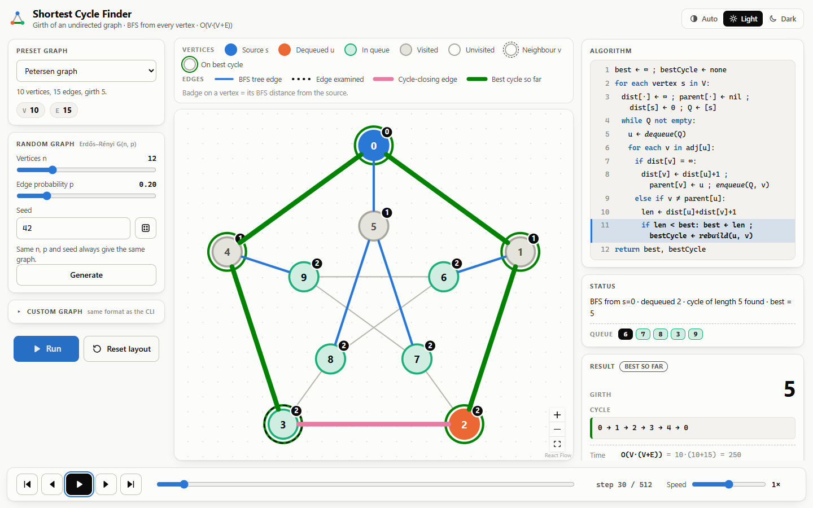

# Shortest Cycle Finder

Finds the **shortest cycle (girth)** of an undirected graph with a **BFS from every vertex**, and animates
the algorithm step by step on a [React Flow](https://reactflow.dev/) canvas. Single-page app, no backend.



## Quick start

```bash
npm install
npm run dev                              # http://localhost:5173
npm test                                 # Vitest: 53 tests
npx tsx src/cli.ts samples/graph.txt     # terminal version, same algorithm module
```

Other scripts: `npm run build` (typecheck + production build), `npm run typecheck`, `npm run lint`, `npm run test:watch`.
Requires Node 22.12+ (Vitest 5's minimum; developed on Node 24).

## Using the app

| Area | What it does |
|---|---|
| **Left panel** | Preset dropdown (triangle, square, pentagon, tree, K4, Petersen, C3 + C6, 3×3 grid, disconnected graph with one cycle) · random Erdős–Rényi G(n, p) with n = 3–40, p = 0–1 and a **seed** (same n, p, seed ⇒ same graph) · a *Custom graph* box using the CLI's text format · **Run** · *Reset layout*. |
| **Canvas** | Circular layout (a few presets ship a nicer hand-made layout), draggable round vertices with a single centred handle, straight undirected edges without arrowheads (floating-edge pattern). A legend sits above it. |
| **Right panel** | The pseudo-code with the executing line highlighted, a one-line status (*"BFS from s=3 · dequeued 5 · cycle of length 4 found · best = 4"*) plus the BFS queue, and the result card (girth, cycle `v1 → v2 → … → v1`, complexity). |
| **Bottom bar** | First · previous · play/pause · next · last, a scrubber labelled `step i / N`, speed 0.25×–4×. Keyboard: `Space` play/pause, `←` `→` step, `Home` `End` first/last. |

Everything drawn is a pure function of `trace[index]` (see `src/viz/visualState.ts`); dragging a vertex only changes its position.

Edge cases handled: **no cycle** (result card says the graph is acyclic), **n > 40** (the result is computed, but no trace is recorded, so there is no animation; a banner explains why and the shortest cycle is highlighted statically — reachable via *Custom graph → Fill with n = 60*), invalid input (self-loops, duplicate edges, out-of-range vertices, wrong edge count are rejected with a line-numbered message).

## Project layout

```
src/algo/graph.ts               Graph type, validation, text parsing (pure TS)
src/algo/shortestCycle.ts       algorithm + trace recording (pure TS, no React imports)
src/algo/generators.ts          presets + seeded random graphs (mulberry32)
src/algo/format.ts              cycle / report formatting shared by CLI and UI
src/algo/shortestCycle.test.ts  Vitest: presets, brute-force cross-check, trace, parsing
src/viz/                        trace event → visual state / status text / layout (pure TS) + tests
src/hooks/                      usePlayback (time-driven index), useTheme
src/components/                 React UI (GraphCanvas, VertexNode, FloatingEdge, panels, bar, …)
src/cli.ts                      terminal entry point
samples/graph.txt               example input (expected girth 4)
REPORT.md                       2–3 page report (problem, algorithm, proof, complexity, tests, screenshots)
docs/screenshots/               images used by the report
```

## The algorithm in one paragraph

For every source `s`, run a BFS that records `dist[]` and `parent[]`. An edge `(u, v)` that is scanned when `v` is already
visited and `v ≠ parent[u]` is a non-tree edge; it closes a cycle, and `dist[u] + dist[v] + 1` bounds its length. The cycle
is rebuilt by walking parent pointers from `u` and `v` up to their lowest common ancestor, so it is always a simple cycle.
The minimum over all sources is the girth; if no non-tree edge ever appears the graph is a forest (`girth = null`).
Time `O(V·(V+E))`, space `O(V+E)`. Details and the correctness argument are in [REPORT.md](REPORT.md) and in the header
comment of `src/algo/shortestCycle.ts`.

**CLI format** — `n m`, then `m` lines `u v` (vertices `0..n-1`; blank lines and `#` comments are ignored; `-` reads stdin):

```
$ npx tsx src/cli.ts samples/graph.txt
Girth: 4
Cycle: 0 → 1 → 2 → 3 → 0
```

## Colours

Hues come from the `dataviz` skill's validated palette, checked with its `validate_palette.js` in light and dark mode
(see `src/index.css` for the tokens). No state depends on hue alone: each also differs in fill, ring, dash or width, and a
legend plus the status line spell the states out in words.

| Role | Light / dark |
|---|---|
| Source vertex, BFS tree edges | blue `#2a78d6` / `#3987e5` |
| Dequeued vertex *u* | orange `#eb6834` / `#d95926` |
| Vertices in the queue | aqua `#1baf7a` / `#199e70` (tinted fill + ring) |
| Cycle-closing edge (flash) | magenta `#e87ba4` / `#d55181` |
| Best cycle so far | green `#008300` / `#0ca30c` (thickest line, ringed vertices) |
| Edge being examined | neutral ink, dotted and moving |

Validator findings, for transparency: the three vertex hues pass every gate in both modes (worst CVD ΔE 9.2 light / 9.4
dark, normal-vision ΔE ≥ 20.9). Blue + magenta + green, used for edges, pass the CVD (≥ 9.9 dark, ≥ 13 light) and
normal-vision (≥ 26) gates. The skill's own all-pairs rule caps a hue-coded palette at three colours; that is why the
edge being examined is neutral and why every state has a non-colour channel. Aqua and magenta are below 3:1 against
the light surface, so (as the skill requires) their meaning is also available as visible text.

## Notes on how it was built

- **Skills.** The brief asks for the `frontend-design` skill; it is **not in the skill list available in this
  environment**, so it was not used. The `dataviz` skill (palette, colour validation, light/dark handling) was used for
  the visual design. `docx`/`pdf` were not needed: the report is `REPORT.md`.
- **React Flow.** The current package `@xyflow/react` (**13.0.2** was the version installed) — not the old `reactflow`.
  The official docs on custom nodes, handles, TypeScript and the floating-edges examples were read; the example pages do
  not show the `FloatingEdge` source, so `src/components/FloatingEdge.tsx` is written from the pattern (line between the
  two centres, clipped to each circle) using `useInternalNode`. API details were checked against the installed type
  definitions, because v13 differs from older docs: `onNodesChange` receives a changeset (`changes.applyTo(nodes)`;
  there is no `applyNodeChanges`), and dark mode is driven by `data-theme` on `<html>`.
- **`best` always equals the length of `bestCycle`.** `dist[u]+dist[v]+1` is the length of a closed walk; it equals the
  cycle length only when the lowest common ancestor is the source. When the rebuilt cycle is shorter, `best` stores the
  rebuilt (true) length, so the UI never shows `best = 5` next to a 3-cycle. The final answer is unaffected (REPORT.md §4).
  The status line shows this case as *"closed walk of length 5 contains a cycle of length 3"*.
- **Windows quirk.** If your shell starts in `e:\…` (lower-case drive) while Node reports `E:\…`, Vitest's default
  `forks`/`threads` pools fail on every test file (`Cannot read properties of undefined (reading 'config')`).
  `vite.config.ts` therefore selects `pool: 'vmThreads'`, which is immune and fast enough here.
- **Limits.** Trace only for n ≤ 40 (`MAX_TRACE_VERTICES`). The densest allowed graph, K40, records 65,642 steps (33 ms).
  The UI accepts custom graphs up to 300 vertices / 5,000 edges; the CLI has no limit (a 5,000-vertex path takes
  about 1 s, G(2000, 0.005) about 1 s: runtime follows V·(V+E)).
