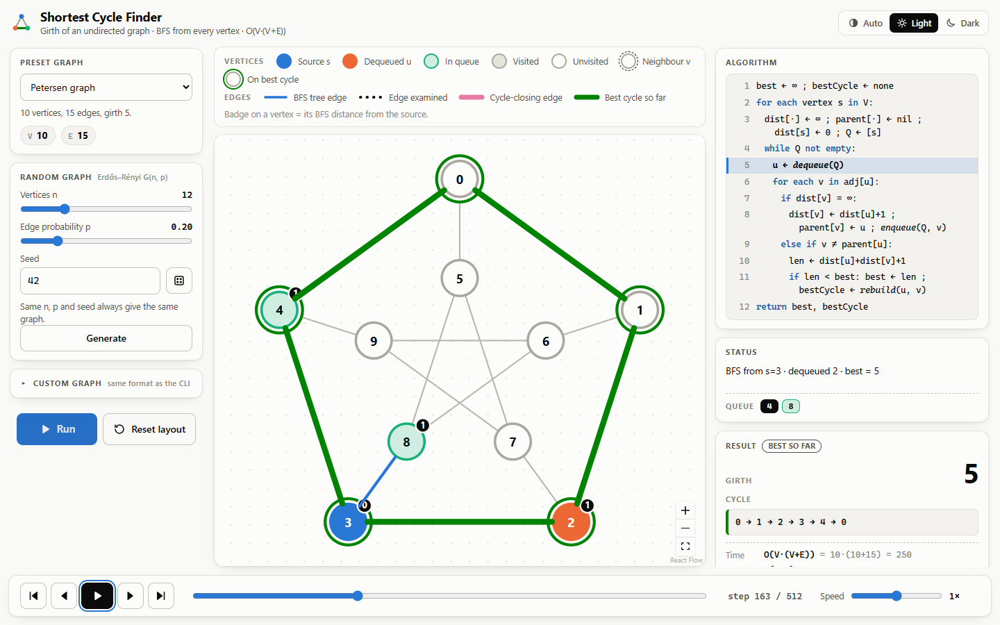
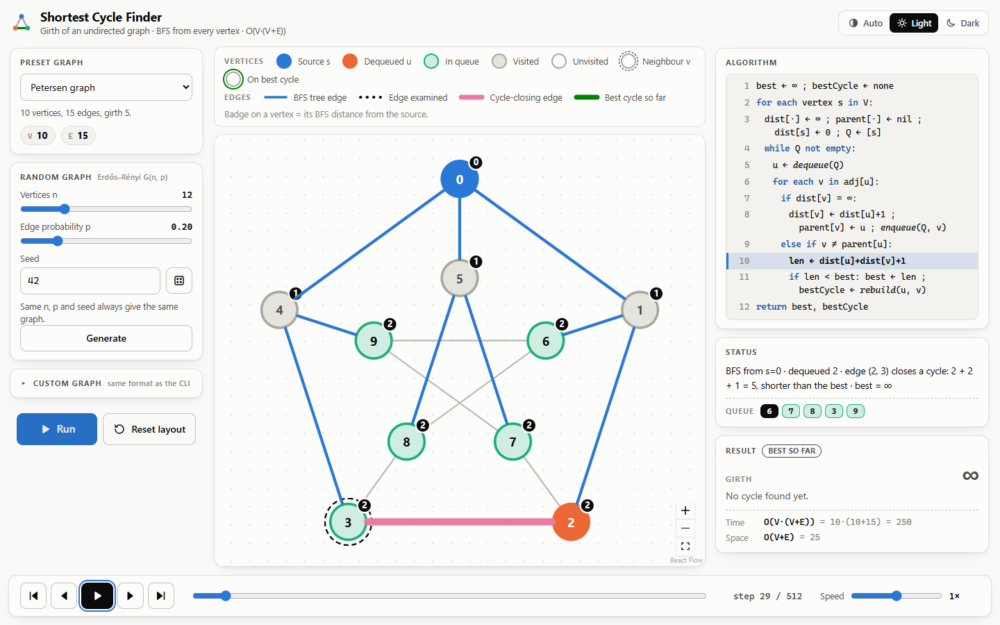
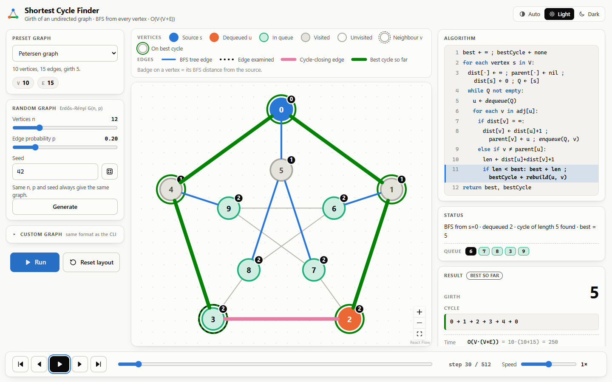
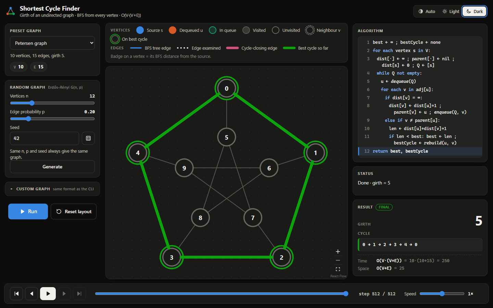
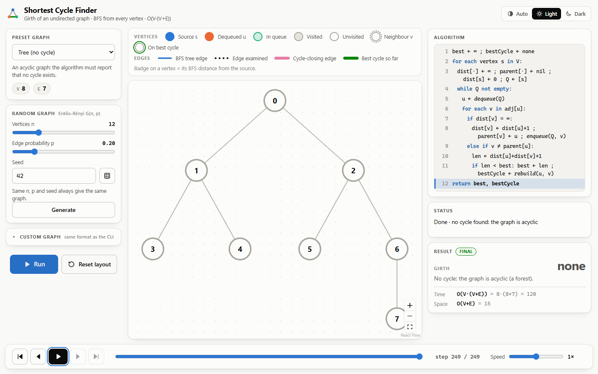
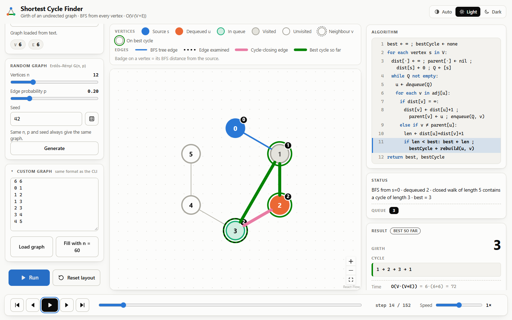
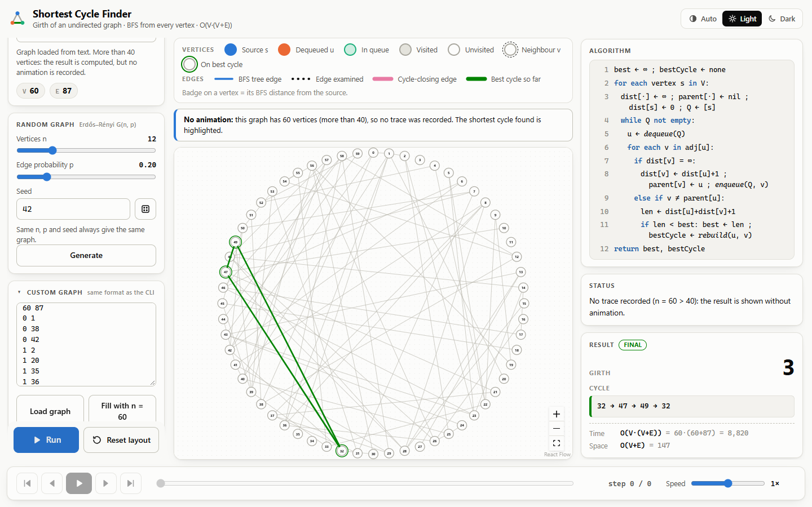

# Shortest Cycle Finder — Report

*Girth of an undirected graph by BFS from every vertex, with a step-by-step visualiser.*

## 1. Problem

Given an undirected simple graph G = (V, E), find a **shortest cycle** (its length is the *girth* of G) or report that
G has no cycle (G is a forest). A cycle is a closed path v₁, v₂, …, v_k, v₁ with k ≥ 3 distinct vertices and every
consecutive pair adjacent. The application computes the girth, returns one shortest cycle as a vertex list, and replays the
computation on a React Flow canvas so that every decision of the algorithm can be watched, paused and rewound.

## 2. Representation

Vertices are the integers `0 … n−1` and the graph is an **adjacency list** `number[][]`: `adj[u]` holds the neighbours of
`u`, symmetric by construction, with **no self-loops and no duplicate edges** (`buildGraph`, `validateGraph` and the text
parser reject them with a message that names the edge; the parser also names the line, e.g. *"Line 3: Duplicate edge (0, 1)"*).

BFS only ever asks "who are the neighbours of u?". An adjacency list answers this in O(deg u) and costs O(V+E) memory,
whereas an adjacency matrix would cost O(V²) memory and O(V) per neighbour scan — wasteful for the sparse graphs this
problem is usually posed on. Using plain arrays also keeps the whole algorithm in dependency-free TypeScript.

## 3. Algorithm

For every source `s`, run a BFS that stores `dist[]` and `parent[]`. When the scan of `u` meets a neighbour `v` that is
already visited and `v ≠ parent[u]`, the edge `(u, v)` is a **non-tree edge** and closes a cycle of length at most
`dist[u] + dist[v] + 1`. The global minimum is kept; the cycle itself is rebuilt by climbing the BFS tree from `u` and from `v`
to their lowest common ancestor (LCA), which yields a *simple* cycle. This is the pseudo-code shown in the UI; its line
numbers are the `pseudoLine` field of every trace event:

```
 1  best ← ∞ ; bestCycle ← none
 2  for each vertex s in V:
 3      dist[·] ← ∞ ; parent[·] ← nil ; dist[s] ← 0 ; Q ← [s]
 4      while Q not empty:
 5          u ← dequeue(Q)
 6          for each v in adj[u]:
 7              if dist[v] = ∞:
 8                  dist[v] ← dist[u]+1 ; parent[v] ← u ; enqueue(Q, v)
 9              else if v ≠ parent[u]:
10                  len ← dist[u]+dist[v]+1
11                  if len < best: best ← len ; bestCycle ← rebuild(u, v)
12  return best, bestCycle
```

`dist[u]+dist[v]+1` is the length of the closed *walk* s ⇝ u – v ⇝ s. It equals the length of the rebuilt cycle only when
the LCA is `s`; otherwise the cycle is shorter by 2·dist[LCA]. Whenever the rebuilt cycle is shorter, the implementation
stores its true length in `best`, so `best = |bestCycle|` holds at every step (the UI shows this as *"closed walk of length 5
contains a cycle of length 3"*). If no non-tree edge is ever met, `best` stays ∞ and the result is `girth = null`.

## 4. Why the minimum over all sources equals the girth

Let g be the girth (g = ∞ for a forest).

**No candidate undercuts g.** For a non-tree edge (u, v) of BFS(s), the tree paths u → lca and v → lca meet only at lca,
and (u, v) is not a tree edge, so these two paths plus the edge form a simple cycle of length
`dist[u]+dist[v]+1 − 2·dist[lca] ≤ dist[u]+dist[v]+1`. Hence every candidate is ≥ the length of a real cycle ≥ g, and `best ≥ g`
at all times. If G is a forest, BFS from any s yields only tree edges, so nothing is ever recorded.

**Some candidate equals g.** Let C be a shortest cycle (|C| = g) and let s be any vertex of C. Distances in G from s to
the vertices of C equal their distances along C: a shorter s–x path P would combine with the longer arc of C into two
distinct s–x paths whose union contains a cycle shorter than g, a contradiction. Write C = (x₀ = s, x₁, …, x_{g−1}).
- *g = 2k+1 odd.* x_k and x_{k+1} are both at distance k from s, so the edge between them is not a tree edge. Both
  endpoints were discovered (at level k) before any level-k vertex is dequeued, so when the first of them is scanned the
  other is visited and is not its parent: the candidate is k + k + 1 = g.
- *g = 2k even.* x_k is at distance k with both cycle-neighbours at k−1, but it has only one parent, so one of the two
  edges (x_{k−1}, x_k) or (x_k, x_{k+1}) is a non-tree edge, say the first. Being a non-tree edge, x_k was already
  discovered when x_{k−1} was scanned, so the candidate (k−1) + k + 1 = g is generated.

So min over all (s, non-tree edge) of `dist[u]+dist[v]+1` is exactly g, and it is reached already from the BFS of any vertex of
C. Because each update stores a real cycle whose length is at most the candidate, and `best ≥ g` always holds, the final `best` is g and
`bestCycle` is a simple cycle of length g. ∎

## 5. Complexity

- **Time O(V·(V+E)).** One BFS enqueues each vertex at most once and scans each adjacency list once, i.e. Σ deg(u) = 2E
  entries with O(1) work each: O(V+E). Resetting `dist`, `parent` and the queue is O(V). There are V sources.
  `rebuild` costs O(V) but runs only when `best` strictly decreases, which happens at most V−2 times in the whole run
  (best ∈ [3, V]): O(V²) in total, which is dominated. Measured: G(1000, 0.01) (E = 4,925) 0.16 s, G(2000, 0.005) 1.0 s,
  G(4000, 0.0025) 2.8 s — roughly proportional to V·(V+E).
- **Space O(V+E).** The adjacency list is O(V+E); `dist`, `parent` and the queue are O(V) and reused across sources.
  The optional trace is the only super-linear part (events × V), which is why it is disabled for n > 40; snapshots that did
  not change are shared between events (K40, the densest case, records 65,642 events in 33 ms).

## 6. Architecture

```
 src/algo (pure TypeScript, no React)            src/viz (pure)              React
 graph.ts ─ validate / parse                      visualState.ts              GraphCanvas ── React Flow
 generators.ts ─ presets, seeded G(n,p)  ──►      trace[i] → vertex/edge      VertexNode (1 centred handle)
 shortestCycle.ts ─ BFS + TraceEvent[]            describe.ts  trace[i] → text FloatingEdge (circle to circle)
        │                                         layout.ts                   PseudoCode · StatusPanel · ResultCard
        └──► cli.ts  (trace off)                                              PlaybackBar ◄── usePlayback (index only)
```

The algorithm module knows nothing about the UI. With `trace: true` it returns an ordered list of `TraceEvent`s
(`START_SOURCE, ENQUEUE, DEQUEUE, TREE_EDGE, SKIP_PARENT, CYCLE_EDGE, BEST_UPDATED, END_SOURCE, DONE`), each carrying
the pseudo-code line, the source, `u`, `v`, and immutable snapshots of the queue, `dist[]`, `parent[]`, `best` and `bestCycle`.
The UI is a **replay**: `usePlayback` owns a single integer `index`, and every colour, label, highlighted line and
counter is computed from `trace[index]` by pure functions in `src/viz` (so stepping backwards or scrubbing needs no
special code). React Flow only owns vertex positions (controlled nodes), so dragging never disturbs the animation. Edges
are drawn by a custom floating edge that runs between the two circle centres and stops on each boundary, which is the
natural undirected, arrowless version of React Flow's floating-edge pattern. The CLI calls the same `shortestCycle`
with the trace off.

## 7. Tests and results

`npm test` (Vitest 5): **53 tests in 2 files, all passing** (≈ 0.9 s).

| Group | Tests | What is checked |
|---|---|---|
| Presets | 11 | C3 = 3, C4 = 4, C5 = 5, tree = none, K4 = 3, Petersen = 5, C3+C6 = 3, 3×3 grid = 4, disconnected-with-one-cycle = 4; every returned cycle is a valid simple cycle of G with `length === girth` |
| Brute force | 3 | (a) the 200 seeded random G(n, p) graphs with n ≤ 8 required by the brief, against exhaustive simple-cycle enumeration: same girth, valid cycle. Uniform G(n, p) on ≤ 8 vertices is a weak sample (only 83 of the 200 contain a cycle, and 82 of those have girth 3), so (b) adds 150 *structured* random graphs (a k-cycle for k = 3…8 plus random pendant vertices, chords and relabelling; girth histogram 3→57, 4→37, 5→23, 6→12, 7→9, 8→12; the "LCA ≠ s" case occurs in 27 of them), and (c) 30 larger graphs check that the result is identical with and without trace |
| Edge cases | 4 | empty graph, isolated vertices, a single edge (parent edge skipped), tail-into-triangle (LCA ≠ s), canonical cycle form |
| Trace | 8 | start/end events, one source block per vertex, line number ↔ event type, all nine event types occur, snapshot consistency, `best` never increases, **no trace when n > 40** (`traceTruncated`) |
| Validation | 6 | self-loop, duplicate edge, out-of-range vertex, asymmetric list, text parsing with line numbers |
| Generators | 5 | same seed ⇒ same graph, p = 0 / p = 1, mulberry32, seed parsing, report formatting |
| Visual state | 16 | `trace[i]` → vertex/edge states and status text, purity, invariants on every step of two traces |

The suite was also checked for sensitivity: removing the `v ≠ parent[u]` test breaks the presets, and changing `+1` to
`+2` breaks the brute-force and trace tests, and ignoring equal-distance non-tree edges (which would lose every odd cycle)
fails 18 tests. `npx tsx src/cli.ts samples/graph.txt` prints `Girth: 4` / `Cycle: 0 → 1 → 2 → 3 → 0`.
Beyond the unit tests, a scripted browser session (Playwright, not part of the repository) ran all nine presets to their last
step and compared the girth, checked on all 512 steps of the Petersen run that the highlighted pseudo-code line matches the
status text, and exercised play/pause, scrubber, speed, keyboard, dragging, reset, random reproducibility, invalid custom
input, the n > 40 case and dark mode: 64 checks, no failures, no console warnings.

## 8. Screenshots

| | |
|---|---|
|  |  |
| **BFS from s = 3 on the Petersen graph.** Blue tree edges, aqua queue, the best cycle found so far (5) stays green. | **Cycle-closing edge.** Edge (2, 3) flashes magenta: 2 + 2 + 1 = 5, shorter than the current best (∞). |
|  |  |
| **Best cycle updated** at line 11; the cycle `0 → 1 → 2 → 3 → 4 → 0` goes into the result card. | **Final state** in the dark theme: girth 5, last step 512 / 512. |
|  |  |
| **No cycle:** the tree preset ends with "the graph is acyclic". | **Walk vs cycle.** From s = 0 the walk through (2, 3) has length 5, but its LCA is 1, so the rebuilt cycle (1 → 2 → 3 → 1) has length 3. |



*n = 60 (> 40): the result is computed and the shortest cycle is highlighted, but no trace is recorded, so the playback bar is
disabled and a banner explains why.*

## 9. Limitations

The animation is limited to n ≤ 40 by design, and its length grows like V·(V+E) (K40 has 65,642 steps, so full-speed
playback of the densest graph is not meant to be watched to the end; the scrubber and *last* button exist for that).
The algorithm finds one shortest cycle, not all of them, and does not try to stop early when `best` reaches 3.
